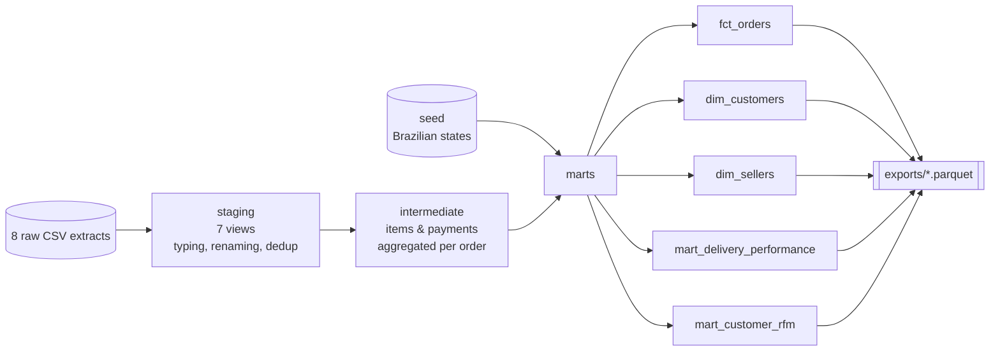

# E-commerce data pipeline · dbt + DuckDB


An analytics-engineering pipeline that turns the raw extracts of a marketplace
(**99,441 real orders** from [Olist](https://www.kaggle.com/datasets/olistbr/brazilian-ecommerce),
Brazil, 2016-2018) into tested, documented tables ready for BI and machine learning.

It is the data foundation of two other projects:
[delivery-delay-prediction](https://github.com/mohfofana/delivery-delay-prediction) and
[customer-segmentation](https://github.com/mohfofana/customer-segmentation).

## Why this project

At La Poste I build Power BI reporting on top of SAP and SQL Server extracts.
A delivery KPI is only useful if "late" means the same thing in every report.
This project applies that idea with analytics-engineering tooling: business
rules live **once**, in versioned SQL, and are **tested** on every run.

## Architecture



| Layer | Materialization | Role |
|---|---|---|
| `staging` | views | One model per source. Types, clean names, fixes source typos (`lenght`), keeps the latest review per order. |
| `intermediate` | views | Aggregates items and payments to the order grain, picks the main seller/category of each order. |
| `marts` | tables | Business-facing tables, documented and tested. |

## The central table: `fct_orders`

One row per order, with the delivery KPIs a carrier would track in its
service-quality reporting:

| KPI | Definition |
|---|---|
| `promised_days` | estimated delivery date minus purchase date |
| `seller_handling_days` | approval to hand-over to the carrier |
| `carrier_transit_days` | hand-over to delivery |
| `delay_days` | delivered date minus promised date |
| `is_late` | delivered after the promised **day** |
| `seller_missed_handover` | parcel handed to the carrier after the seller's deadline |
| `seller_customer_distance_km` | great-circle distance between the seller's and the customer's state capitals (approximation, see below) |

## Data quality

`dbt build` runs **32 data tests** before any table is considered usable:

- primary keys `unique` + `not_null` on every model;
- referential integrity (`relationships`) orders → customers, items → orders, customers → states;
- domain checks (`accepted_values`) on order status and review score;
- a custom generic test, `unique_combination`, for composite keys (written in `macros/`, no external package);
- singular tests: no delivery before purchase; payments that cover less than half of items + freight are flagged (`warn`).

## What the data says (first look)

Computed from `fct_orders` on delivered orders:

- **6.8 %** of orders arrive after the promised date.
- Late orders get an average review of **2.26 / 5** vs **4.28** when on time; **63 %** of late orders get a 1 or 2 star review.
- Olist promises **24 days** on average but delivers in **12.6** (median 10.2): promises are very conservative, yet lateness still happens.
- The **Nordeste** region has twice the late rate of the Sudeste (12.7 % vs 6.1 %).
- Lateness peaked at **12.9 %** in Q1 2018.

These findings are developed in [delivery-delay-prediction](https://github.com/mohfofana/delivery-delay-prediction).

## Run it

```bash
pip install -r requirements.txt
dbt build --profiles-dir .        # seeds, 14 models, 32 tests (~5 s)
python scripts/export_marts.py    # marts -> exports/*.parquet
dbt docs generate --profiles-dir . && dbt docs serve --profiles-dir .   # lineage & docs
```

CI (`.github/workflows/pipeline.yml`) runs the same build and tests on every
push and every Monday, then publishes the Parquet marts as a build artifact.

## Design choices

- **DuckDB** instead of a cloud warehouse: zero infrastructure, runs in CI in seconds, and the SQL ports to Snowflake / BigQuery / Fabric with minor changes.
- **Raw files read in place** (`read_csv_auto` on gzip CSV via a macro) rather than loaded first: simpler, and the staging layer is the single entry point.
- **Distance approximation**: the public dataset gives zip prefixes, not exact addresses. I use the coordinates of each state's capital. It is coarse within a state but captures what matters for delivery (crossing the country vs staying local).
- **Late = calendar day**: an order delivered at 23:00 on the promised day is on time, as a customer would see it.

## Data & license

Data: *Brazilian E-Commerce Public Dataset by Olist*, published on Kaggle under
[CC BY-NC-SA 4.0](https://creativecommons.org/licenses/by-nc-sa/4.0/). The raw
files are included (gzip) for reproducibility, unchanged. Code: MIT.
